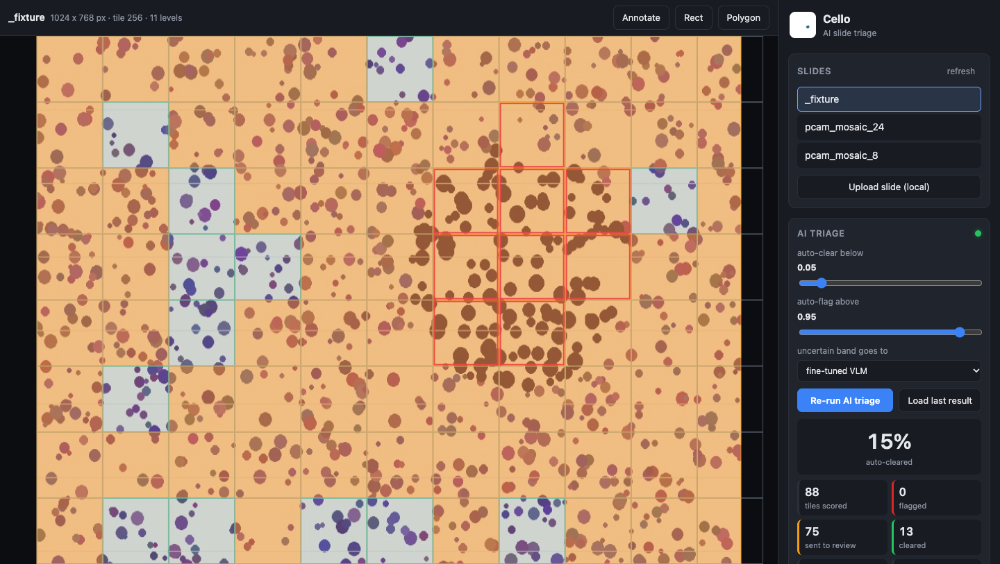

# Cello — AI slide triage viewer

Cello is a browser-based whole-slide-image viewer (OpenSeadragon + Annotorious, React/Vite,
Express) that now doubles as the demo UI for **pathfrontier**: open a slide, press
**Run AI triage**, and watch a tumor heatmap paint over the tissue with the cost / sensitivity
summary next to it. Red = auto-flagged, amber = sent for review (fine-tuned VLM or pathologist),
green = auto-cleared. Flip on ground truth to compare, click a cell for `p_tumor`, the stage that
decided, and the VLM's one-line reason.

It runs with **zero AWS**: tiles are read from `tiles/` on disk, comments go to a JSON file, and
the ML service is reached through the backend's `/ml/*` proxy. The original S3 mode is preserved
behind `STORAGE_MODE=s3`.

## Quickstart (no AWS, five commands)

From the monorepo root (`pathfrontier/`):

```bash
make setup        # uv venv + pip install -e ".[dev]"  and  npm install for backend + frontend
make tile         # builds the demo mosaic slide + ground truth -> tiles/pcam_mosaic_24
make dev          # backend :4001, frontend :4000, ML service :8008, all in one terminal
open http://localhost:4000
# then: pick pcam_mosaic_24 -> Run AI triage -> toggle "show ground truth"
```

No model yet? `make dev-stub` runs a canned ML stub (`cello/backend/scripts/ml-stub.mjs`) so the
whole UI flow works offline. Deep link for demos: `http://localhost:4000/?image=pcam_mosaic_24&triage=1&gt=1`.

Docker instead: `docker compose up --build` from the monorepo root (frontend :4000, backend :4001,
ml :8008; `tiles/ results/ cache/ data/` are bind-mounted).

## Architecture

```
 browser (:4000)                     cello/backend (Express, :4001)             pathfrontier (FastAPI, :8008)
 ┌──────────────────────────┐        ┌───────────────────────────────┐         ┌──────────────────────────┐
 │ React + Vite             │ tiles  │ GET /osd/images               │         │ GET  /health             │
 │  OpenSeadragon viewer ───┼───────▶│ GET /osd/dzi/:id   (parse XML)│         │ POST /predict/tile       │
 │  HeatmapOverlay (canvas) │        │ GET /osd/tile/:id/:l/:x/:y    │         │ POST /predict/slide      │
 │  TriagePanel ────────────┼──/ml──▶│ ALL /ml/*  ──── stream proxy ─┼────────▶│ GET  /jobs/:id           │
 │  Comments / Annotorious ─┼───────▶│ GET|POST|DELETE /comments     │         │ GET  /heatmap/:id        │
 │  Slide list + upload ────┼───────▶│ POST /api/upload-local        │         └───────────┬──────────────┘
 └──────────────────────────┘        └──────┬──────────────┬─────────┘                     │ reads tiles
                                            │              │                               ▼
                                   data/comments.json   tiles/<id>/<id>.dzi  +  tiles/<id>_files/<level>/<x>_<y>.jpeg
                                   data/slides/<id>.gt.json                    (written by scripts/tile_slide.py)
```

The frontend never talks to the ML service directly, so CORS and hostnames are a backend concern
only. The heatmap JSON (`docs/CONTRACTS.md` §8) is drawn on a single canvas that is re-projected
on every OpenSeadragon `update-viewport` event: tile `(x, y)` covers
`[x*tile_size*scale, y*tile_size*scale, tile_size*scale, tile_size*scale]` image pixels.

## Environment variables

Backend (`cello/backend/.env`, see `.env.example`):

| Variable | Default | Meaning |
|---|---|---|
| `PORT` | `4001` | HTTP port |
| `STORAGE_MODE` | `local` | `local` (disk, zero AWS) or `s3` |
| `TILES_DIR` | `<repo>/tiles` | DZI pyramids (`<id>/<id>.dzi` or `<id>.dzi`, plus `<id>_files/`) |
| `UPLOAD_DIR` | `<repo>/data/slides` | raw uploads from `/api/upload-local`; also where `<id>.gt.json` lives |
| `DATA_DIR` | `<repo>/data` | `comments.json` |
| `ML_SERVICE_URL` | `http://localhost:8008` | upstream for `/ml/*` |
| `CORS_ORIGIN` | `*` | comma-separated allow-list |
| `JSON_BODY_LIMIT` | `50mb` | `express.json` limit |
| `MAX_UPLOAD_MB` | `2048` | local upload size cap |
| `AWS_REGION`, `AWS_ACCESS_KEY`, `AWS_SECRET_KEY`, `S3_BUCKET`, `S3_TILES_BUCKET` | – | required only when `STORAGE_MODE=s3` |
| `DATABASE_URL` | – | not wired; see `commentsRoute.ts` for the Prisma switch |

Relative paths resolve against the process cwd (`cello/backend`), e.g. `TILES_DIR=../../tiles`.
`<repo>` defaults are derived from the backend's own location, so `npm run dev` from
`cello/backend` finds the monorepo's `tiles/` without any env.

Frontend (`cello/frontend/.env`): `VITE_BACKEND_URL` (default `http://localhost:4001`). Baked in at
build time; pass `--build-arg VITE_BACKEND_URL=…` to the Dockerfile.

ML service: `PATHFRONTIER_TILES_DIR` (default `tiles/`), see the root `.env.example`.

## Backend API (added for the demo)

Full reference with payloads: [`Cello_API_Documentation.md`](./Cello_API_Documentation.md).

| Method | Path | Purpose |
|---|---|---|
| GET | `/health` | liveness + effective config |
| GET | `/osd/images` | imageIds that have a `.dzi` |
| GET | `/osd/dzi/:imageId` | `{width,height,tileSize,overlap,format,maxLevel}` |
| GET | `/osd/tile/:imageId/:level/:x/:y` | tile bytes (404 if missing, traversal-safe) |
| GET | `/osd/gt/:imageId` | `data/slides/<id>.gt.json` ground truth, or 404 |
| GET/POST/DELETE | `/comments[/:imageId\|/:id]` | JSON-file comment store |
| ALL | `/ml/*` | streaming proxy to the ML service (JSON + multipart, status passthrough) |
| POST | `/api/upload-local` | save a slide to `UPLOAD_DIR`, reply with the tiler command |
| GET | `/api/upload-mode` | `{"mode":"local"\|"s3"}` |

## Developing

```bash
cd cello/backend  && npm install && npm run dev      # tsx watch, :4001
cd cello/frontend && npm install && npm run dev      # vite, :4000
cd cello/backend  && npm run ml-stub                 # optional canned ML service on :8008

# quality gates (what CI runs)
cd cello/backend  && npm run lint && npm run build
cd cello/frontend && npm run lint && npm run build
```

Smoke-test fixture: `tiles/_fixture` (1024x768, 11-level pyramid) with `data/slides/_fixture.gt.json`
is a tiny synthetic slide for exercising the tile route, overlay and ground truth without the real
tiler; `make clean-tiles` removes it.

Layout of the frontend source:

```
src/api/client.ts        axios instance (VITE_BACKEND_URL) + errorMessage()
src/api/slidesApi.ts     listImages, getDzi, getGroundTruth (tolerant gt.json parser), comments CRUD, uploadLocal
src/api/mlApi.ts         startSlideJob, pollJob, getHeatmap, predictTile, runSlideTriage (poll loop)
src/components/OSDviewer.tsx      viewer built from /osd/dzi, Annotorious drawing, comment modal
src/components/HeatmapOverlay.tsx canvas overlay + hover/click tooltip
src/components/TriagePanel.tsx    thresholds, run/poll/progress, summary stats, overlay toggles
src/components/FileUpload.tsx     slide list from /osd/images + local/S3 upload
src/components/comments.tsx       list/delete comments
```

## S3 mode (original deployment)

Set `STORAGE_MODE=s3` and provide `AWS_REGION`, `AWS_ACCESS_KEY`, `AWS_SECRET_KEY`, `S3_BUCKET`
(raw uploads) and `S3_TILES_BUCKET` (DZI pyramids). The backend then:

- streams tiles from `S3_TILES_BUCKET` at `<imageId>/<level>/<x>_<y>.jpeg` (legacy layout) or
  `<imageId>_files/<level>/<x>_<y>.jpeg`, and parses `<imageId>.dzi` for `/osd/dzi`;
- lists `/osd/images` from the bucket's `.dzi` keys;
- accepts the chunked multipart upload (`/api/start-upload` → `/api/upload-part` → `/api/complete-upload`)
  into `S3_BUCKET`; the frontend switches to it automatically via `/api/upload-mode`;
- serves presigned URLs at `/view/image/:id/url`.

Tiling in that deployment is done by the Lambda in `docker_tiling/` (pyvips → DZI → S3), triggered
by the upload. Comments remain in the JSON store unless you wire Prisma (`prisma/schema.prisma` is
kept; PostgreSQL via `DATABASE_URL`).

## Screenshots



_`docs/screenshots/triage.png` is the `_fixture` slide with the ML stub (headless Chrome capture).
Replace it with `pcam_mosaic_24` + the real service after the demo run._

## Maintainers

- Kaushik Karthikeyan
- Rachit Bisht
